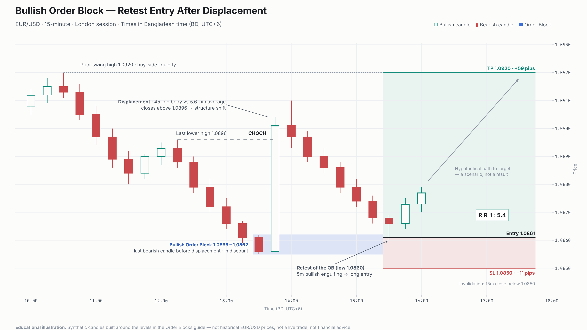

# Bullish Order Block — Retest Entry After Displacement

> **Educational illustration.** The candles are synthetic. They were built around the levels in the guide's "Real Example — EUR/USD Bullish OB" and are not historical EUR/USD prices. This is not a live trade, a verified result, or financial advice.

**Proposed placement:** `content/en/smc/order-blocks.mdx` → _Bullish Order Block → Real Example — EUR/USD Bullish OB_. This chart replaces the ASCII sketch and shows the example's levels on a price chart.

---

## Market Context

| Item        | Value                                                         |
| ----------- | ------------------------------------------------------------- |
| Instrument  | EUR/USD                                                       |
| Timeframe   | 15-minute (setup) · 5-minute (entry confirmation)             |
| Session     | London (the OB forms at 1:30 PM BD)                           |
| Time zone   | Bangladesh time (BD, UTC+6), matching the rest of the guide   |
| Bias        | Bullish after the structure shift                             |
| Data        | Synthetic. The levels come from the guide; the candles do not |

## What the Chart Shows (Observations)

These describe the candles on the chart. They do not interpret them.

1. **Prior swing high at 1.0920 (10:30).** The sell-off starts below this high, so resting buy-side liquidity sits above it.
2. **Sell-off with lower highs and lower lows.** The last lower high before the low is **1.0896 (12:15)**.
3. **Last bearish candle at 13:30: 1.0855 – 1.0862.** Its high-to-low range is the Order Block.
4. **Displacement at 13:45.** One bullish candle has a **45-pip body**, compared with a **5.6-pip average** for the earlier bodies. It closes at 1.0901, above the 1.0896 lower high. The move peaks at **1.0910** on the next candle.
5. **Retracement into the OB.** Over the following two hours price pulls back. The 15:30 candle tags **1.0860**, which is inside the OB zone.

## Technical Reasoning (Interpretation)

- **Why this candle is the OB:** it is the last opposing (bearish) candle before a strong bullish displacement, which is the guide's definition.
- **Why the OB is valid:** it passes the guide's validation rules:
  - **Displacement:** the 45-pip body is more than 2× the average candle (_Pro Tip 1_).
  - **Structure shift:** the displacement closes above the last lower high.
  - **Discount:** the dealing range of the new leg is 1.0855 – 1.0910, so equilibrium is 1.0883. The OB (1.0855 – 1.0862) sits below it, in discount.
  - **Fresh:** the 15:30 retest is the first time price returns to the zone.
  - **Timing:** it formed during the London session.
- **Imbalance:** the displacement leaves a Fair Value Gap between the OB high (1.0862) and the 14:00 low (1.0893). The retracement fills that gap completely before it reaches the OB. In this example the FVG is therefore context, not an entry zone.
- **Terminology:** the guide says the displacement is "breaking structure". In a downtrend, the first close above the last lower high is a **Change of Character (CHOCH)**, so the chart labels it CHOCH. A Break of Structure (BOS) would be a later break in the new bullish direction. Both satisfy the guide's rule that an OB must be "created before a BOS or CHOCH".

## Setup Conditions and Confirmation

This follows the guide's **Model 2: Conservative — Confirmation at OB**.

1. Mark the bullish OB only after the displacement and the structure shift.
2. Wait for price to retrace into the OB zone (1.0855 – 1.0862).
3. Drop to the 5-minute chart and wait for a bullish confirmation. In this example it is a **bullish engulfing** candle.
4. Enter long after the confirmation. Place the stop below the OB and target the next liquidity level.

## Trade Levels and Risk-to-Reward

| Level           | Price      | Rationale                                       |
| --------------- | ---------- | ----------------------------------------------- |
| **Entry**       | 1.0861     | After the 5m bullish engulfing inside the OB    |
| **Stop Loss**   | 1.0850     | 5 pips below the OB low (guide: 5–15 pips)      |
| **Take Profit** | 1.0920     | Prior swing high (buy-side liquidity)           |
| **Risk**        | 11 pips    | 1.0861 − 1.0850                                 |
| **Reward**      | 59 pips    | 1.0920 − 1.0861                                 |
| **R:R**         | **1 : 5.4** | 59 ÷ 11 = 5.36                                 |

The dashed arrow toward the target is a **hypothetical scenario**. It is not a recorded outcome.

## Invalidation and Alternative Scenarios

- **Invalidation:** a 15-minute close below **1.0850**. That means price has accepted below the OB, and the bullish premise fails.
- **No confirmation:** if price trades through the OB and no 5m bullish confirmation forms, there is no trade. An untriggered setup is not a loss.
- **Bearish alternative:** if the OB fails, it can flip into a bearish **Breaker Block** (see [Breaker Blocks](/en/smc/breaker-blocks)). The original downtrend would then be back in control.
- **Partial move:** price may react from the OB without reaching 1.0920. The 1.0910 displacement high is the first obstacle, and some traders use it as an earlier, more conservative exit. Treat it as optional management, not part of the core rule.

## Risk Management

- Risk **1–2% of the account** on the setup, as the guide recommends. With an 11-pip stop, size the position so that 11 pips equals that amount (see the [Position Size Calculator](/en/tools/position-calculator)).
- Trade the **first test** of the OB only. After this retest the zone is mitigated.
- A high R:R does not make a trade more likely to succeed. Wide targets are reached less often, so judge the setup by its conditions, not by its R:R.
- Keep the guide's limit of **2–3 quality OB setups per day**.

---

_Source levels: `content/en/smc/order-blocks.mdx`. The guide's "Result: 1:5.4 R:R" is the planned risk-to-reward of the example. This sample does not present it as a verified trade result._
