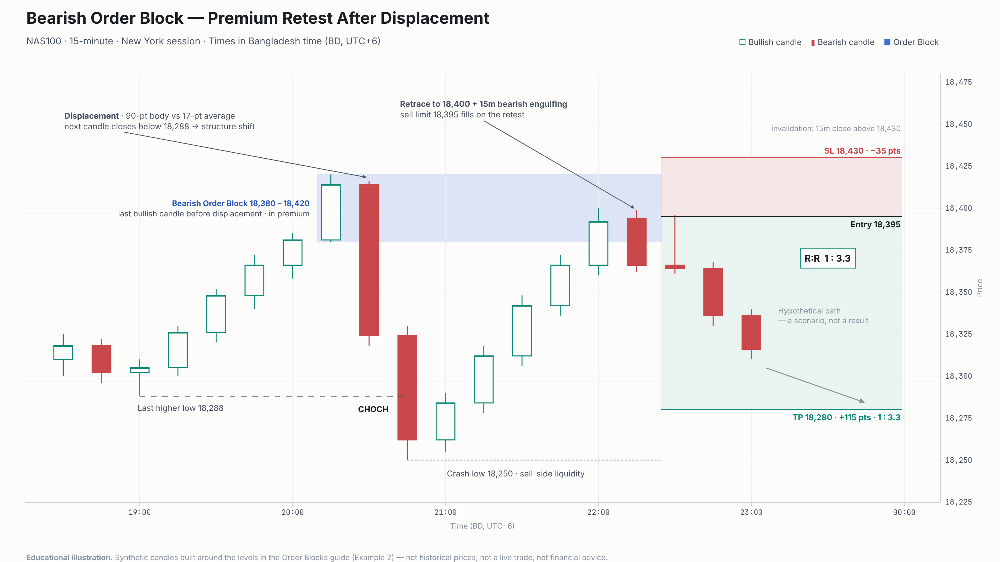
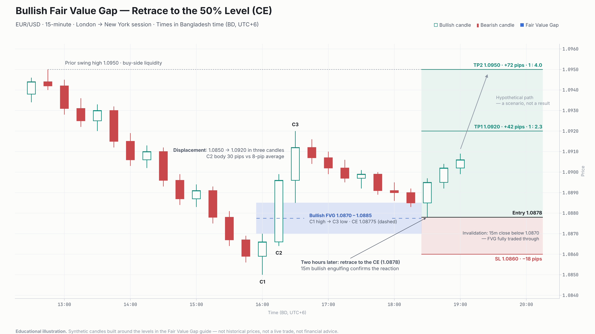
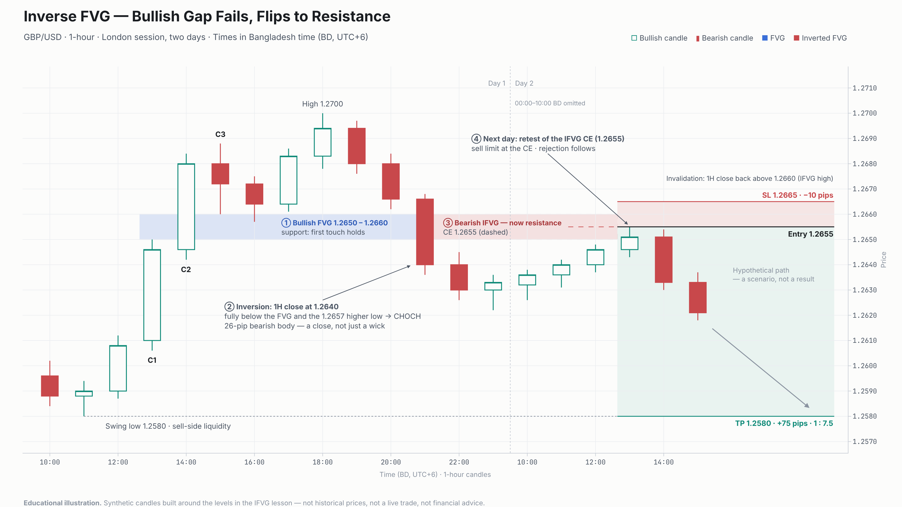
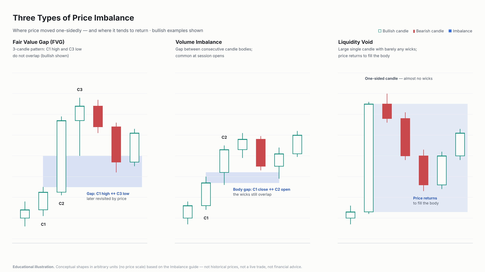

# SMC Chart Set — OB, FVG, IFVG, Imbalance

These four charts follow the style of the approved prototype in `samples/order-block-chart/`, the Bullish OB chart for EUR/USD.

> **Educational illustrations.** All candles are synthetic. They were built around the levels quoted in each lesson and are not historical prices. Arrows toward a target show hypothetical scenarios, not results. Nothing here is financial advice.

| # | Chart | Lesson it illustrates | Proposed placement |
|---|-------|-----------------------|--------------------|
| 1 | Bearish Order Block — NAS100 15m | `smc/order-blocks.mdx` → Example 2 | Replace or accompany "Example 2: NAS100 — Bearish OB" |
| 2 | Bullish FVG — EUR/USD 15m | `smc/fair-value-gap.mdx` → Real example + R:R Examples | Under "Bullish FVG Trading Setup" |
| 3 | Bearish IFVG — GBP/USD 1H | `academy/ict-smc-course/20-ifvg.mdx` → Example | Under "Example" |
| 4 | Three types of imbalance | `smc/imbalance.mdx` → Types of Imbalance | Under "Types of Imbalance" |

---

## 1. Bearish Order Block — Premium Retest After Displacement

**Context:** NAS100, 15-minute chart, New York session, times in BD.

**Observations**

- Price rallies after the New York open. The last higher low of that rally is at 18,288.
- The last bullish candle before the drop spans **18,380 – 18,420**. This is the Order Block.
- A bearish displacement candle follows. Its body is **90 points**, against a **17-point** average.
- The next candle closes below 18,288 and prints the **18,250** low.
- Price then retraces to **18,400**, inside the OB, and a **15m bearish engulfing** candle forms.

**Interpretation**

- The close below the last higher low is a bearish **CHOCH**.
- The OB sits in **premium**: the dealing range is 18,250 – 18,420, so equilibrium is 18,335 and the OB is above it.
- The retest is the first touch of a fresh OB, which passes the guide's validation rules.

**Trade levels (from the guide)**

| | Price | |
|---|---|---|
| Short | 18,395 | |
| Stop | 18,430 | 10 points above the OB |
| Target | 18,280 | Placed just ahead of the 18,250 sell-side liquidity |
| Risk / Reward | 35 / 115 points | **R:R 1 : 3.3** (115 ÷ 35 = 3.29) |

**Invalidation:** a 15m close above 18,430, which means price has been accepted back above the OB.

**Note on the entry:** the guide's entry (18,395) is above the level where a 15m bearish engulfing candle would close. The chart therefore models it as a **sell limit at 18,395, placed after the engulfing and filled on the retest**. If price does not come back up, the order is not filled and there is no trade.

---

## 2. Bullish Fair Value Gap — Retrace to the 50% Level (CE)

**Context:** EUR/USD, 15-minute chart, from late London into the New York session, times in BD.

**Observations**

- Price drops from the **1.0950** swing high to **1.0850**.
- It then rallies to **1.0920** in three candles. C2, the middle candle, has a **30-pip** body against an **8-pip** average.
- The rally leaves a **bullish FVG between 1.0870 and 1.0885**, the gap between C1's high and C3's low.
- Two hours later, price retraces to **1.0878**. This is the **CE (consequent encroachment)**, the 50% level of the FVG; the exact midpoint is 1.08775.
- A **15m bullish engulfing** candle forms at the CE.

**Interpretation:** the FVG is an inefficiency left by the displacement. A first retrace to the CE that is rejected suggests buyers are defending it.

**Trade levels**

The entry comes from the guide's example narrative. The stop and both targets come from the guide's "R:R Examples" section.

| | Price | |
|---|---|---|
| Entry | 1.0878 | Limit order at the CE; the engulfing confirms the reaction |
| Stop | 1.0860 | 10 pips below the FVG (the guide allows 5–10) |
| TP1 | 1.0920 | +42 pips, **1 : 2.3** |
| TP2 | 1.0950 | +72 pips, **1 : 4.0** |

**Invalidation:** a 15m close below 1.0870. At that point the FVG has been fully traded through and may turn into a bearish IFVG (see chart 3).

**Inconsistencies in the guide:**

- The "R:R Examples" section uses an entry of **1.0875**, labelled as the "50% of FVG". The true midpoint is 1.08775, which the guide's own narrative rounds to 1.0878.
- The same section says the stop at 1.0860 is "15 pips below FVG". It is actually **10 pips** below the FVG; the 15 pips is the distance from the entry.
- The guide's 1:3 and 1:5 ratios are correct for an entry at 1.0875. With the CE entry at 1.0878 used in this chart, the ratios become **1:2.3 and 1:4.0**.
- I left the guide unchanged; these are listed for you to decide.

---

## 3. Inverse FVG — Bullish Gap Fails, Flips to Resistance

**Context:** GBP/USD, 1-hour chart, London session on two consecutive days. The overnight hours (00:00–10:00 BD) are left out.

**Observations, in order**

1. A **bullish FVG at 1.2650 – 1.2660** forms in London. Its first touch holds as support, and price rallies to **1.2700**.
2. A 1H candle **closes at 1.2640**. That close is below the whole FVG and below the 1.2657 higher low, so it is a **full inversion plus a bearish CHOCH**.
3. The zone is now a **bearish IFVG**, acting as resistance. Price stays below it overnight.
4. The next day, price rallies to **1.2655**, the IFVG's CE, and is rejected.

**Interpretation:** the buyers who defended the FVG are now trapped. The former support zone becomes a level where sellers can add to positions.

**Trade levels (from the lesson)**

| | Price | |
|---|---|---|
| Sell | 1.2655 | CE of the IFVG |
| Stop | 1.2665 | Above the IFVG |
| Target | 1.2580 | Swing low (sell-side liquidity) |
| Risk / Reward | 10 / 75 pips | **R:R 1 : 7.5** |

**Invalidation:** a 1H close back above 1.2660, the top of the IFVG.

**Risk note:** a 10-pip stop on a 1H chart is very tight. A 1 : 7.5 ratio describes the reward if the target is reached. It does not say how likely that is.

**Inconsistency in the lesson:** the lesson contradicts itself.

- Its "Definition" bullets and comparison table describe the "Bullish IFVG" as a former bearish FVG "traded through bearishly", acting as "support for further downside".
- Its "How It Works" section, and its own example, say the opposite: a bullish FVG that is closed through becomes a **bearish IFVG** (resistance), and a bearish FVG that is closed through becomes a **bullish IFVG** (support).
- This chart follows "How It Works". The Definition bullets and the table should be corrected later. I did not change the lesson.

---

## 4. Three Types of Price Imbalance

This is a conceptual comparison. It shows candle shapes only, with no price scale. It uses the three types the guide lists:

| Type | How to identify it | What the chart shows |
|------|--------------------|----------------------|
| **Fair Value Gap** | C1 high and C3 low do not overlap (bullish case) | The gap between C1 and C3, later revisited by price |
| **Volume Imbalance** | Consecutive candle **bodies** gap; the wicks still overlap | C2 opens above C1's close |
| **Liquidity Void** | One large candle with barely any wicks | Price later returns into its body |

**Wording note:** the guide says price "will almost always return" to fill imbalances. This chart says "tends to return" instead, because the guide doesn't back the stronger claim with data. Its own section "Not All Imbalances Fill" also says many do not.

---

## Shared Risk Management (from the guides)

- Risk **1–2%** per trade, and size each position from the distance between entry and stop.
- Trade only fresh, untested zones, and stay aligned with the higher-timeframe bias.
- Wait for confirmation, or accept that a limit order at the zone may fill without it.
- A higher R:R usually means a lower hit rate. The ratios above describe each setup; they are not statistics on how often it works.
